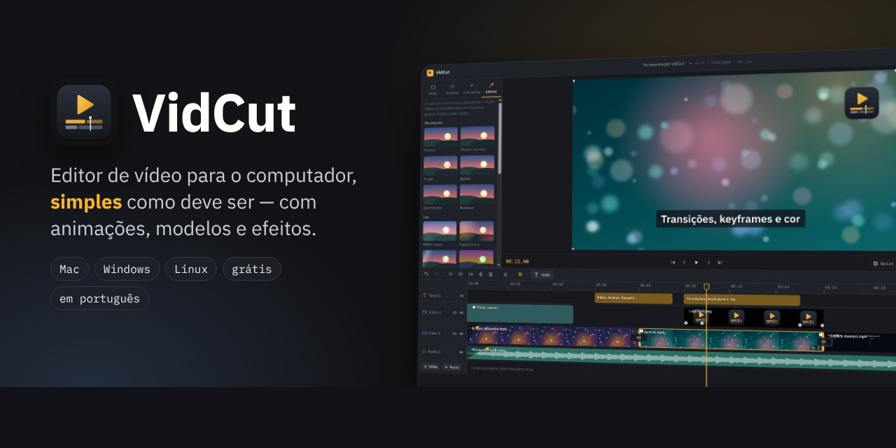
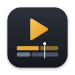
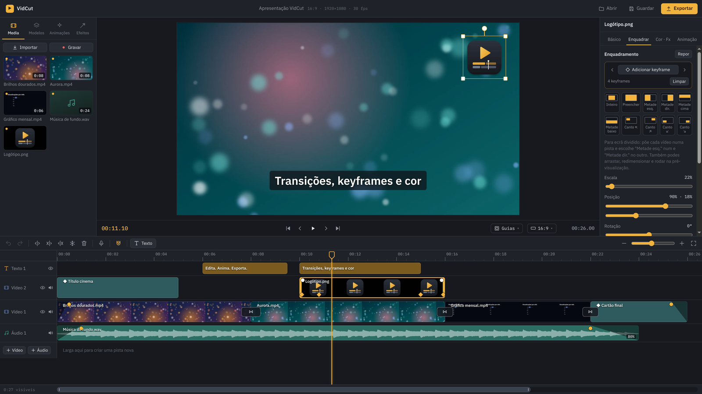
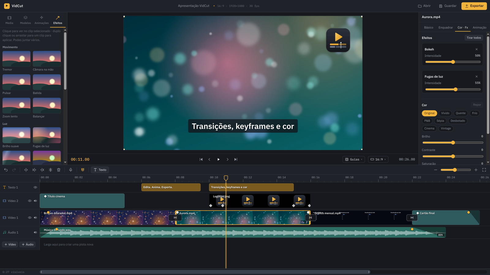
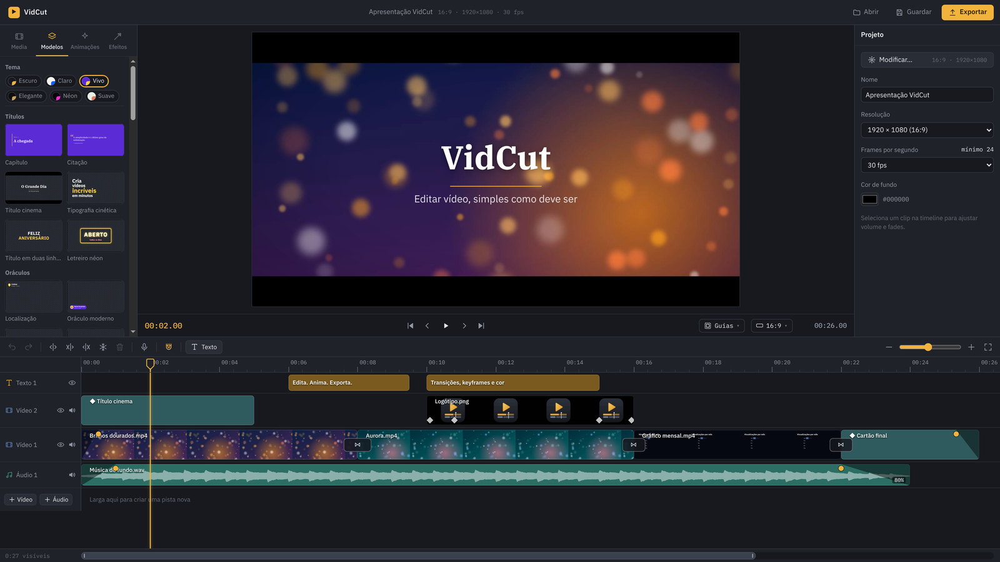
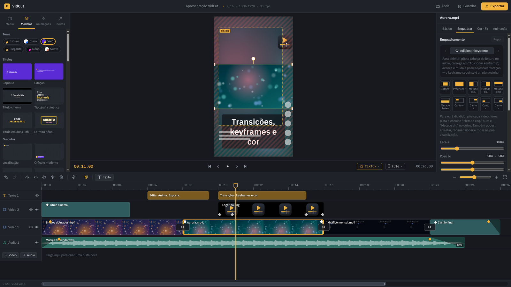
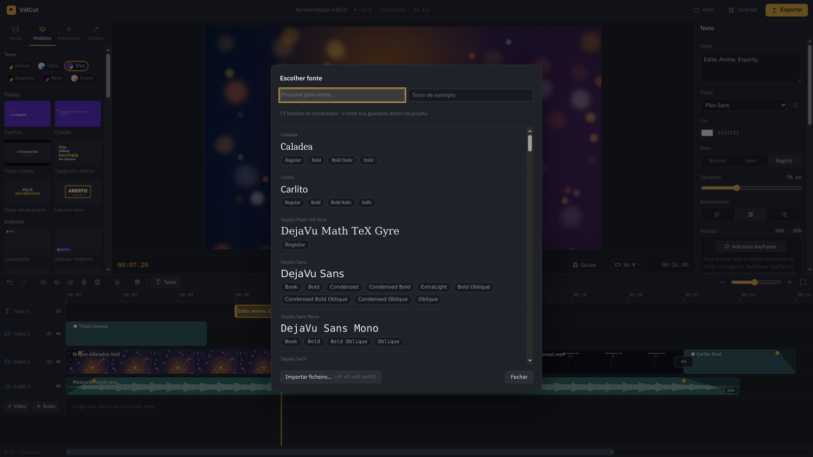
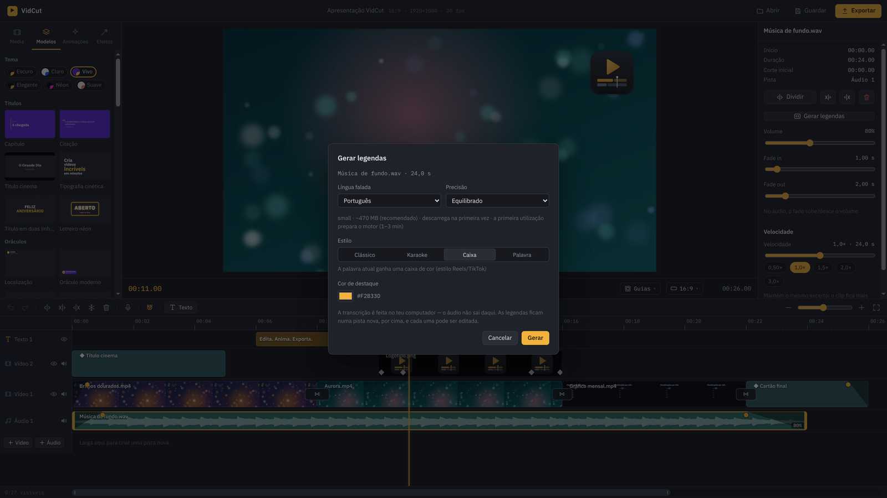
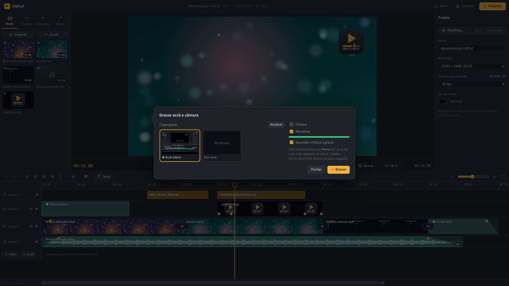
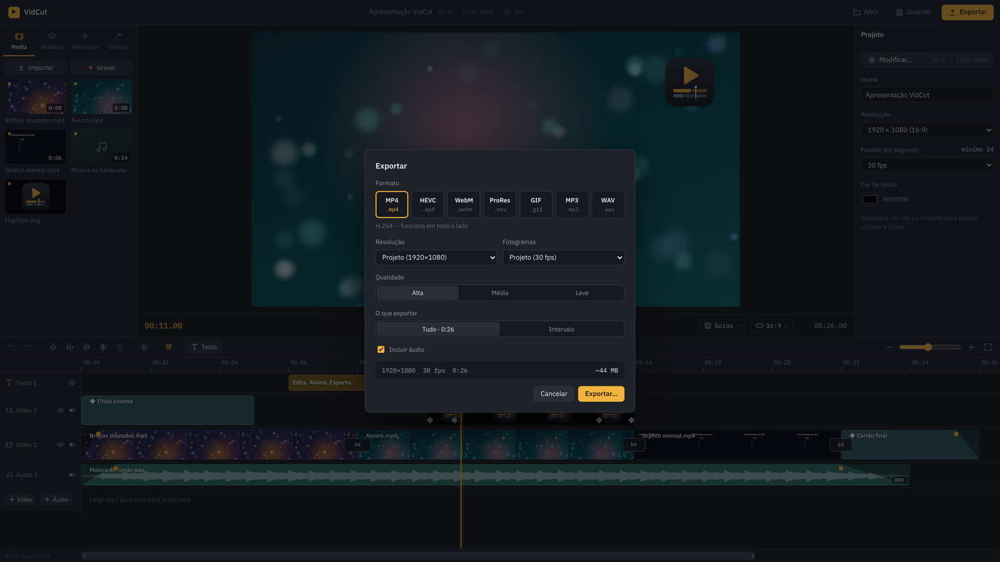

<p align="center">
  
</p>

<p align="center">
  <br>
  <b>Editor de vídeo para o computador, simples como deve ser.</b><br>
  Corta, junta, anima e exporta — com modelos, efeitos, música, stickers, legendas automáticas e gravação de ecrã.
</p>

<p align="center">
  <a href="https://github.com/Qwerty-PT/VidCut/releases/latest"></a>
  
  
  <a href="LICENSE"></a>
</p>

<p align="center">
  <a href="https://github.com/Qwerty-PT/VidCut/releases/latest"><b>⬇ Descarregar</b></a> ·
  <a href="#o-que-faz">O que faz</a> ·
  <a href="#ecrãs">Ecrãs</a> ·
  <a href="#instalar">Instalar</a> ·
  <a href="#desenvolver">Desenvolver</a>
</p>

---

O **VidCut** é um editor de vídeo e áudio ao estilo do CapCut, feito para correr no teu computador — sem contas, sem marcas de água e sem enviar os teus vídeos para lado nenhum. A pré-visualização e o export usam a **mesma composição** (Remotion), por isso o que vês é exatamente o que sai.

## O que faz

**Editar**
- Timeline com várias pistas de vídeo, áudio e texto; mover, aparar, dividir (`S`, `Q`, `W`), copiar/colar, apagar e fechar espaço
- Íman, zoom até ao fotograma (também a arrastar na régua), forma de onda real, seleção múltipla, desfazer/refazer
- Velocidade (0,25× a 4×) e **curvas de velocidade**, fades arrastáveis, separar o áudio, **congelar fotograma**, **dividir nas mudanças de cena**, **cortar silêncios**, **substituir media**, **inverter**
- **Máscaras** (círculo, retângulo, faixa, coração…) com borda suave
- Enquadramento com o rato (mover, redimensionar, rodar), disposições rápidas (ecrã dividido, imagem dentro de imagem), **keyframes** com curvas IBM
- Mudar o formato a qualquer momento (16:9, 9:16, 1:1, 4:5…) com **fundo desfocado** para encher as barras

**Som e música**
- **Música e efeitos sonoros** incluídos (10 músicas, 23 efeitos), criados para o VidCut e livres de direitos
- **Cortes ao ritmo da música**: batidas detetadas, íman nas batidas e "encaixar clips no ritmo"
- **Normalizar volume** (−14 LUFS, o nível das redes) e **keyframes de volume** desenhados no próprio clip
- **Reduzir ruído** da voz e **ducking automático** (a música baixa quando alguém fala)

**Texto e legendas**
- Textos com animações de entrada e saída (máquina de escrever, palavra a palavra…), caixa, sombra, **contorno e brilho**
- **Fontes do computador** (com pesquisa) ou importadas — ficam guardadas dentro do projeto
- **Legendas automáticas** feitas no próprio computador (Whisper), em vários estilos: clássico, karaoke, caixa, palavra a palavra; importar/exportar `.srt`

**Modelos, animações e efeitos**
- **5 modelos de projeto** prontos (lançamento de app, promoção, tutorial, reel ao ritmo, vlog) — só falta pôr os teus vídeos
- **39 modelos** editáveis (títulos, oráculos, redes sociais, dispositivos, gráficos, eventos, finais com QR…) com **6 temas** de cor
- Animações **Lottie** incluídas e as tuas (`.json` / `.lottie`)
- **20 efeitos** (tremor, VHS, glitch, fugas de luz, bokeh, neve, ondulação…) com intensidade ajustável
- 13 **transições** (dissolver, deslizar, chicote, glitch, círculo…)
- **Stickers e emojis**: 23 stickers com texto editável e ~1500 emojis, com animações em loop
- Tudo com **pré-visualização no ecrã principal**: um clique mostra, um duplo clique aplica

**Gravar**
- **Ecrã e câmara** ao mesmo tempo — o ecrã vai para a timeline e a câmara fica num canto
- **Narração** com o vídeo a tocar, diretamente para uma pista de áudio

**Exportar**
- MP4 (H.264), HEVC, WebM, ProRes, GIF, MP3 e WAV; de 480p a 4K; tudo, os clips selecionados ou um intervalo
- **Guias das redes** (TikTok, Reels, Shorts) para nada importante ficar tapado

**E ainda**
- **Atualizações automáticas** — a app avisa quando há versão nova e instala com um clique
- Pré-visualização em **ecrã inteiro** (tecla F) e **proxies** para vídeos pesados (4K, HEVC)
- **Projetos portáteis**: reencontra os ficheiros quando a pasta muda e **empacota** o projeto com a media para outro computador
- Gravação automática contínua; projetos `.vidcut` em JSON

## Ecrãs

<table>
  <tr>
    <td width="50%"><br><sub><b>Editor</b> — enquadrar com o rato e keyframes</sub></td>
    <td width="50%"><br><sub><b>Efeitos</b> — vários por clip, com intensidade</sub></td>
  </tr>
  <tr>
    <td><br><sub><b>Modelos</b> — 39 modelos e 6 temas de cor</sub></td>
    <td><br><sub><b>9:16</b> — fundo desfocado e guias do TikTok</sub></td>
  </tr>
  <tr>
    <td><br><sub><b>Fontes</b> — as do computador, com pesquisa, ou importadas</sub></td>
    <td><br><sub><b>Legendas automáticas</b> — no próprio computador</sub></td>
  </tr>
  <tr>
    <td><br><sub><b>Gravar ecrã e câmara</b></sub></td>
    <td><br><sub><b>Exportar</b> — 7 formatos, até 4K</sub></td>
  </tr>
</table>

## Instalar

Descarrega a última versão em **[Releases](https://github.com/Qwerty-PT/VidCut/releases/latest)**:

| Sistema | Ficheiro |
|---|---|
| **macOS** (Apple Silicon) | `VidCut-x.y.z-arm64.dmg` — abre e arrasta o VidCut para Aplicações |
| **Windows** | `VidCut-x.y.z-Setup.exe` (instalador) ou `VidCut-x.y.z-Portatil.exe` (sem instalar) |
| **Linux** | `VidCut-x.y.z-x86_64.AppImage` (qualquer distribuição) ou `VidCut-x.y.z-amd64.deb` |

> [!NOTE]
> A app ainda não tem certificado da Apple nem da Microsoft.
> - **macOS:** se disser que a app está danificada ou não abre, corre `xattr -cr /Applications/VidCut.app` no Terminal.
> - **Windows:** em "O Windows protegeu o computador", carrega em **Mais informações → Executar mesmo assim**.
> - **Linux:** `chmod +x VidCut-*.AppImage`; se não arrancar, corre com `--no-sandbox`.

Depois de instalada, a app procura atualizações sozinha (também em **Ajuda → Procurar atualizações**).

## Desenvolver

Precisas do [Node.js](https://nodejs.org) 20 ou mais recente.

```bash
git clone https://github.com/Qwerty-PT/VidCut.git
cd VidCut
npm install
npm run dev
```

- **Modelos próprios:** junta um ficheiro `.tsx` à pasta [`modelos/`](modelos/_LEIA-ME.md) — aparece logo na app
- **Instaladores:** `npm run dist:mac`, `npm run dist:win` ou `npm run dist:linux`
- **Publicar uma versão:** sobe a versão no `package.json`, escreve as novidades em [`NOVIDADES.md`](NOVIDADES.md) e faz push para o `main` — o GitHub Actions compila para os três sistemas e cria a Release
- Documentação completa (funcionalidades, atalhos, estrutura do código): **[LEIA-ME.md](LEIA-ME.md)**

**Feito com** [Electron](https://www.electronjs.org) · [React](https://react.dev) · [Remotion](https://www.remotion.dev) · [whisper.cpp](https://github.com/ggerganov/whisper.cpp) · [lottie-web](https://github.com/airbnb/lottie-web) · tipografia [IBM Plex](https://www.ibm.com/plex/)

## Licença

O VidCut é **código aberto**, com a [licença MIT](LICENSE): podes usar, alterar e distribuir à vontade, desde que mantenhas o aviso de direitos de autor. Sugestões e melhorias são bem-vindas (abre um *issue* ou um *pull request*).

O VidCut usa o [Remotion](https://www.remotion.dev/license), que tem licença própria: gratuito para uso individual e empresas até 3 pessoas; equipas maiores precisam da licença de empresa do Remotion. Os modelos, as animações Lottie, os stickers, as músicas e os efeitos sonoros incluídos foram criados para o VidCut; os emojis são os [Fluent Emoji](https://github.com/microsoft/fluentui-emoji) da Microsoft (MIT); alguns modelos foram adaptados dos [templates MIT da React Video Editor](https://github.com/reactvideoeditor/remotion-templates).
